<!-- Cards in assets/ are generated by .github/workflows/profile-cards.yml from profile.yml.
     Edit profile.yml (not the SVGs) and push to re-render. assets/footer-light.svg is a
     light-theme copy of the footer that the same workflow derives with sed. -->

<picture>
  <source media="(prefers-color-scheme: light)" srcset="assets/readme-kit/header-about-light.svg" />
  
</picture>

I'm a software developer who likes working across the whole stack. Most of my code is in **Python, JavaScript and TypeScript**, I build **Android apps in Java and Kotlin**, and I reach for **C and C++** when I want to work close to the metal.

- 📱 Building Android apps with Java and Kotlin
- ⚙️ Writing C and C++ for low-level work
- 🤖 Exploring AI-assisted development
- 🤝 Open to collaborating on projects

<picture>
  <source media="(prefers-color-scheme: light)" srcset="assets/readme-kit/header-stack-light.svg" />
  
</picture>

<picture>
  <source media="(prefers-color-scheme: light)" srcset="assets/readme-kit/header-stats-light.svg" />
  
</picture>

<picture>
  <source media="(max-width: 600px) and (prefers-color-scheme: light)" srcset="assets/github-stats-compact-light.svg" />
  <source media="(max-width: 600px)" srcset="assets/github-stats-compact.svg" />
  <source media="(prefers-color-scheme: light)" srcset="assets/github-stats-light.svg" />
  
</picture>

<picture>
  <source media="(prefers-color-scheme: dark)" srcset="https://raw.githubusercontent.com/SakshiSeth0804/SakshiSeth0804/output/github-snake-dark.svg" />
  <source media="(prefers-color-scheme: light)" srcset="https://raw.githubusercontent.com/SakshiSeth0804/SakshiSeth0804/output/github-snake.svg" />
  
</picture>

<picture>
  <source media="(prefers-color-scheme: light)" srcset="assets/readme-kit/header-connect-light.svg" />
  
</picture>

<picture>
  <source media="(prefers-color-scheme: light)" srcset="assets/footer-light.svg" />
  
</picture>

Profile cards made with <a href="https://github.com/Sagargupta16/readme-kit-action">readme-kit</a>, <a href="https://github.com/Sagargupta16/github-stats-card-action">github-stats-card-action</a> and <a href="https://github.com/Platane/snk">snk</a>. Design adapted from <a href="https://github.com/Sagargupta16">Sagargupta16</a>.

